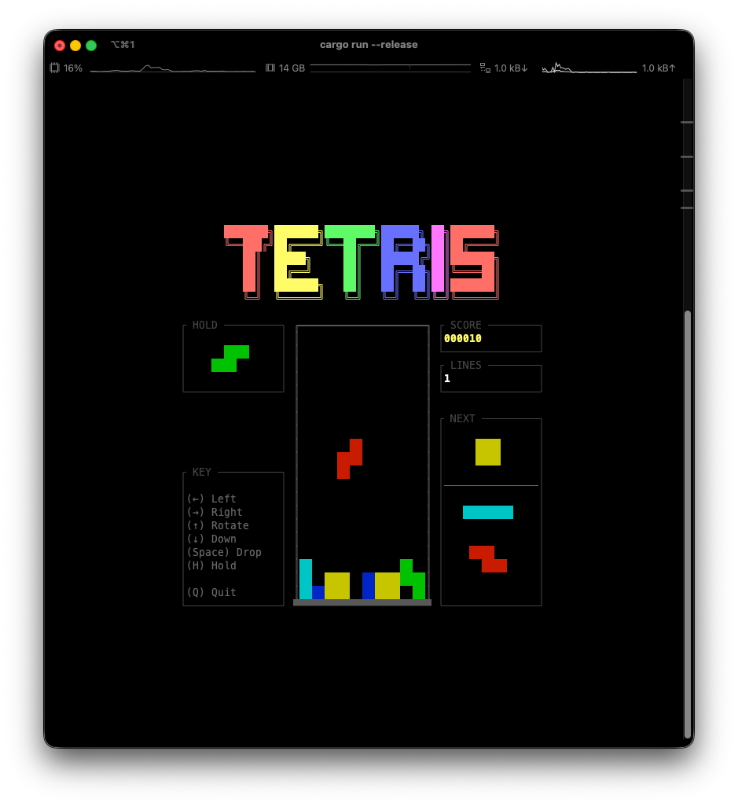
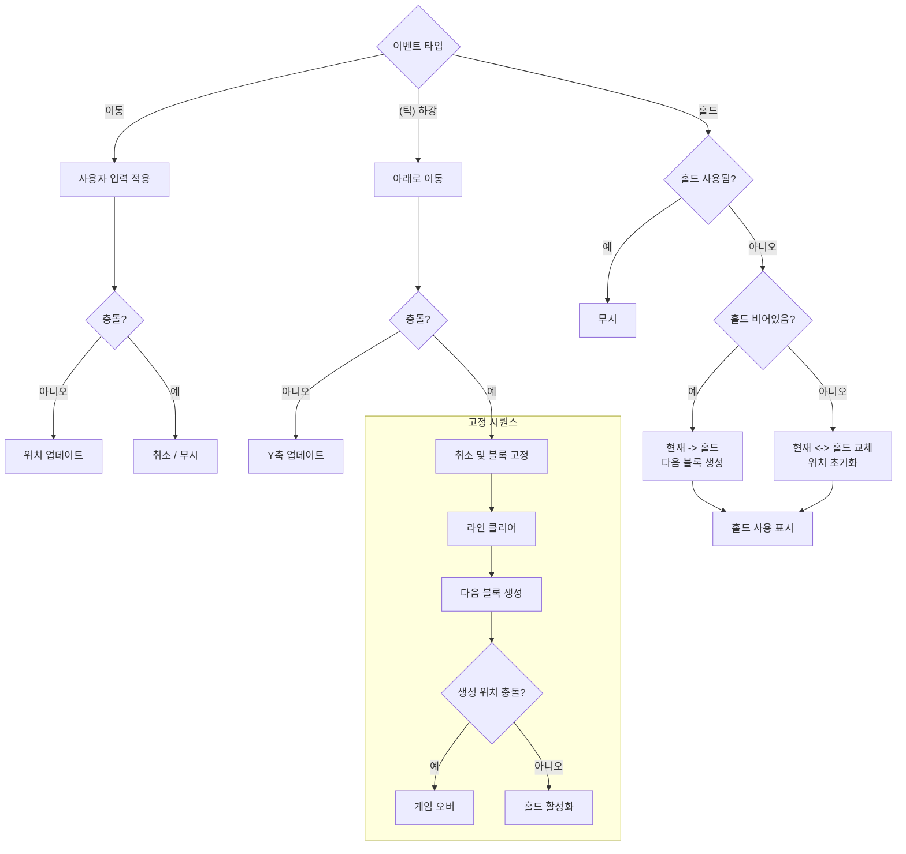
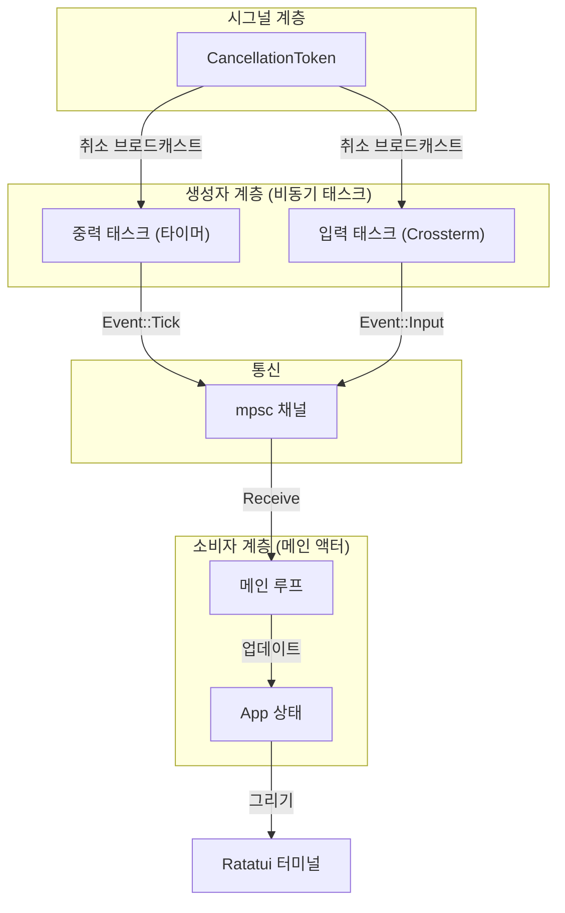

# Tetris TUI

Rust로 작성된 터미널용 간단한 테트리스 게임입니다.



## 🚀 주요 기능

- **게임플레이**: 라인 클리어 및 점수 계산, 홀드 기능을 포함한 기본적인 테트리스를 구현했습니다.
- **TUI 인터페이스**: `ratatui`를 사용하여 반응성이 뛰어난 터미널 UI를 구축했습니다.
- **비동기 엔진**: `tokio`를 기반으로 효율적인 이벤트 루프를 구현했습니다.

## 🎮 게임 조작법

| 키 | 동작 |
| :--- | :--- |
| **← / →** | 왼쪽 / 오른쪽 이동 |
| **↑** | 회전 |
| **↓** | 소프트 드롭 (천천히 내리기) |
| **Space** | 하드 드롭 (즉시 내리기) |
| **H** | 블록 홀드 |
| **Q** | 종료 |

## 🛠️ 설치 및 실행

[Rust](https://www.rust-lang.org/tools/install)가 설치되어 있어야 합니다.

```bash
# 저장소 복제
git clone -b tetris2026-tui https://github.com/hot666666/Tetris.git
cd Tetris

# 게임 실행
cargo run --release
```

## 🏗️ 구성 소개

### 의존성
- **[ratatui](https://github.com/ratatui-org/ratatui)**: 터미널 UI 렌더링.
- **[crossterm](https://github.com/crossterm-rs/crossterm)**: 크로스 플랫폼 터미널 핸들링.
- **[tokio](https://tokio.rs/)**: 이벤트 루프를 위한 비동기 런타임.

### 게임 로직 흐름

핵심 게임 루프는 이동, 충돌 감지 및 블록 고정을 처리합니다.



### 이벤트 파이프라인

입력 및 타이머 이벤트는 `tokio` 채널을 사용하여 동시에 처리됩니다.



## 📜 라이선스

이 프로젝트는 MIT 라이선스에 따라 라이선스가 부여됩니다. 자세한 내용은 [LICENSE](LICENSE) 파일을 참조하십시오.